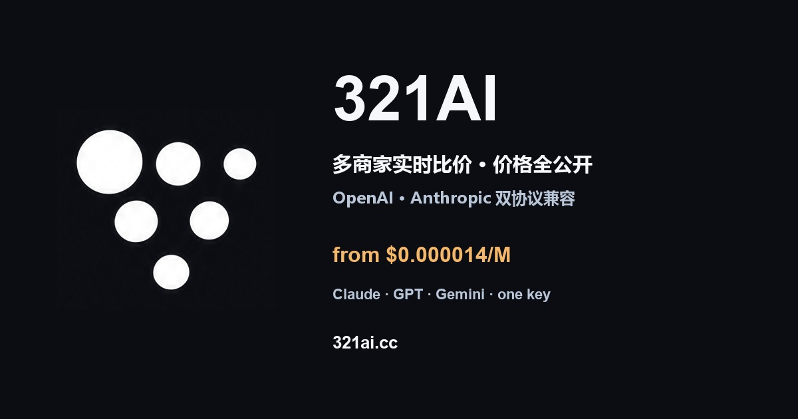
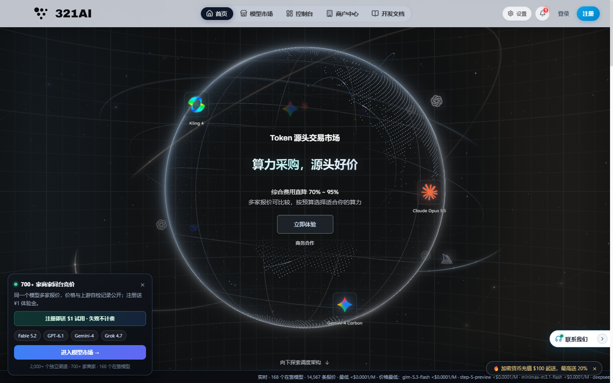
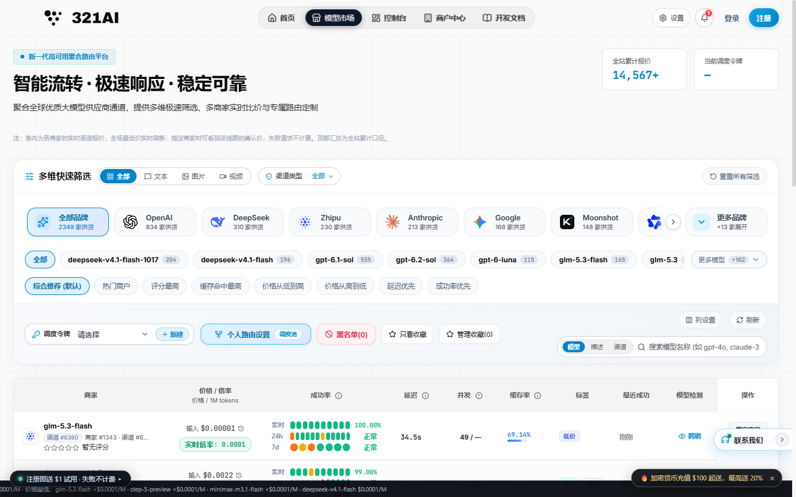
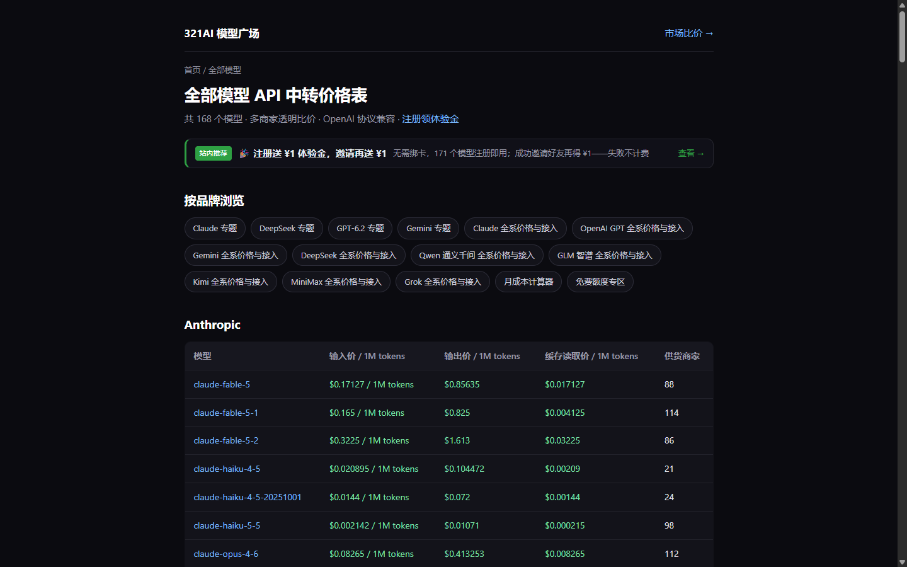
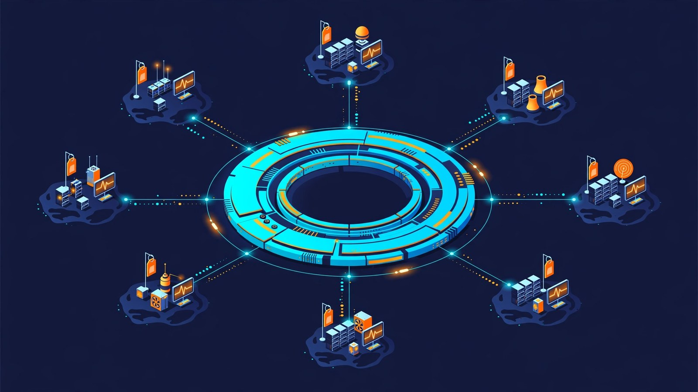
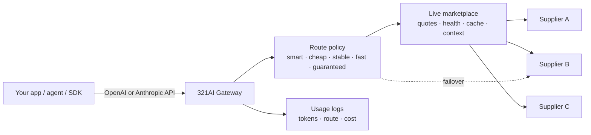
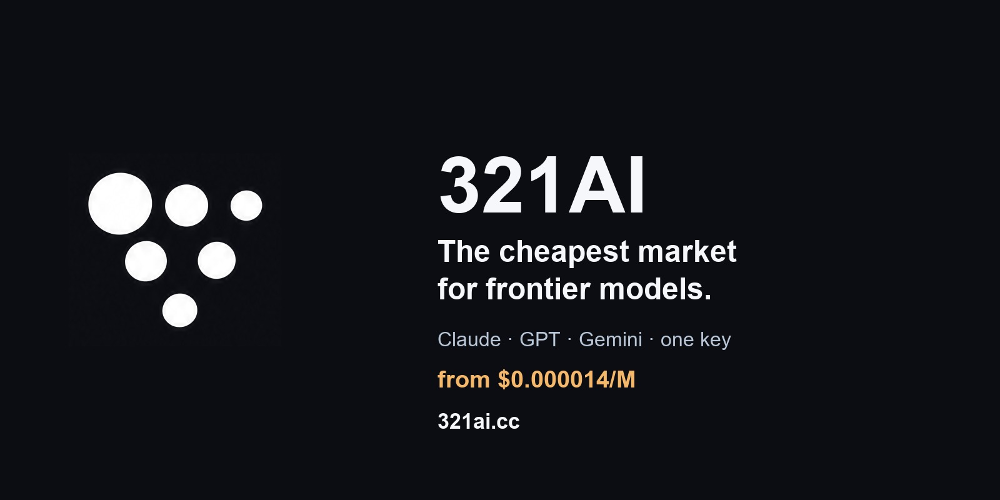

<p align="center">
  <a href="https://321ai.cc">
    
  </a>
</p>

<h1 align="center">321AI — The Cheapest Market for Frontier Models</h1>

<p align="center"><a href="README.zh-CN.md">简体中文</a> | <strong>English</strong></p>

<p align="center">
  <strong>The cheapest way to call Claude, GPT &amp; Gemini.</strong><br>
  680+ suppliers bid for every request — from <strong>$0.000014/M</strong>.<br>
  <strong>$1 free credit</strong> to start. Works with Claude Code, Codex &amp; Cursor.
</p>

<p align="center">
  <a href="https://321ai.cc"></a>
  <a href="LICENSE"></a>
  <a href="https://github.com/321aicc/321ai/stargazers"></a>
  <a href="https://321ai.cc/v1/models"></a>
  <a href="https://321ai.cc"></a>
</p>

<p align="center">
  <a href="#screenshots">Screenshots</a> ·
  <a href="#why-321ai">Why 321AI</a> ·
  <a href="#quick-start">Quick start</a> ·
  <a href="#routing">Routing</a> ·
  <a href="#pricing">Pricing</a> ·
  <a href="#ecosystem">Ecosystem</a> ·
  <a href="#faq">FAQ</a> ·
  <a href="#sponsors--partners">Sponsors</a>
</p>

<p align="center">
  <a href="https://321ai.cc/#/market"><strong>Claude Sonnet 5.5 from $0.0405/M · GPT-6.2 Astra from $0.0675/M · GLM-5.3-Flash from $0.000014/M</strong></a><br>
  <sub>Live marketplace snapshot · prices move with supply · final route price shown at checkout</sub>
</p>

---

## Today's price anchors

| Model | 321AI input / output (per 1M) | Official input / output | Approx. official price |
|---|---:|---:|---:|
| **Claude Sonnet 5.5** | **$0.0405 / $0.2025** | $2 / $10 | **2.0%** |
| **GPT-6.2 Astra** | **$0.0675 / $0.3375** | $8 / $40 | **0.84%** |
| **Gemini 4 Neon** | **$0.0990 / $0.4950** | $3 / $15 | **3.3%** |
| **GLM-5.3** | **$0.00651 / $0.02046** | $1.40 / $4.40 | **0.47%** |
| **Qwen4 Max** | **$0.0540 / $0.1620** | $1.50 / $4.50 | **3.6%** |
| **DeepSeek V4.1 Flash** | **$0.001875 / $0.0075** | $0.30 / $1.20 | **0.63%** |

<sub>Snapshot: 2026-11-26 19:08 JST. Marketplace prices change daily; the confirmed route price and final invoice are the source of truth.</sub>

## The short version

You want Claude, GPT, Gemini, DeepSeek, Qwen, GLM, Grok and the next model that ships next week — without maintaining a different SDK, a different key, and a different billing dashboard for each one.

**321AI makes them one endpoint.**

```text
https://321ai.cc/v1
```

Create a key. Change `base_url`. Ship. Your existing OpenAI or Anthropic client keeps working, while 321AI shops the request across a live marketplace of independent suppliers and routes it to a qualified channel.

> **Not another locked-in reseller.** A marketplace with many merchants, visible quotes, per-request billing and failover built in.

> [!NOTE]
> 321AI is an independent aggregation gateway. Model names and trademarks belong to their respective owners. 321AI is not affiliated with OpenAI, Anthropic, Google or any model vendor.


## The model layer is broken

You have a Claude key, an OpenAI key, a Gemini key, a DeepSeek key, a Qwen key, a GLM key, a Grok key — and a spreadsheet to remember which one is cheap, which one is healthy, and which one just changed its price.

Your agent does not care about any of that. It cares about one thing: **getting the right model, at the right price, right now.**

The old model-access stack forces you to choose between **one upstream** and **one more integration**. 321AI removes that choice.

> **The next generation of AI products will not be built on one model. They will be built on the ability to route between many.**

## One key. The whole market.

<div align="center">

| **160+** | **2,000+** | **700+** | **14,000+** |
|:---:|:---:|:---:|:---:|
| frontier & open models | supplier channels | independent suppliers | live merchant quotes |

</div>

<sub>Live marketplace snapshot; supply and prices move with the market. The marketplace is the source of truth.</sub>

**Same model. Better route. Better economics.**

321AI turns model access into a live market:

- Every request can compete across multiple supplier channels.
- Every channel carries a quote, a health signal, a latency profile and a cache profile.
- You choose the policy — or pin the merchant — and the gateway does the boring part.
- When a channel gets slow, expensive or unavailable, the route can move before your users feel it.

## What builders build with 321AI

| Builder | Job to be done | Why 321AI |
|---|---|---|
| **Coding agents** | Claude Code, Cursor, Cline, Codex CLI | One Anthropic/OpenAI-compatible endpoint; switch models without reconnecting tools |
| **AI products** | Chat, copilots, research, workflow automation | Multi-model routing behind one API contract |
| **Agent platforms** | Many users, many models, many providers | Per-token routes, logs and cost visibility |
| **Growth teams** | High-volume generation and batch jobs | Cheap/stable policies and live merchant comparison |
| **Infra teams** | Reliability without running an LLM proxy team | Built-in failover, marketplace health and usage logs |
| **Indie builders** | Ship fast without enterprise procurement | One key, no minimum, no lock-in |

## The 321AI effect

- **Less spend** — compare the market, not a single markup.
- **More uptime** — a bad supplier does not have to become a bad request.
- **Faster shipping** — OpenAI/Anthropic compatibility means no rewrite.
- **Better decisions** — see which route actually served each request.
- **No lock-in** — your code, your prompts, your choice of supplier.
- **Agent-ready** — one endpoint for the tools your agent already speaks.

## What we refuse to do

- **No single-upstream dependency.** A marketplace with one supplier is not a marketplace.
- **No invisible routing.** You can see the merchant, quote, health and route behind a request.
- **No invented benchmarks.** The screenshots and numbers in this repository are real product captures or live marketplace data.
- **No fake lock-in.** If 321AI is not the best route tomorrow, your code should still work somewhere else.

## Manifesto

> Models are becoming commodities. **Access should not be.**
>
> The model layer should be a market: many suppliers, visible prices, real competition, and a clean API on top.
>
> 321AI exists to make that market usable by one developer, one agent, or one company — without giving any single gatekeeper the power to set the price.

---

---

<a id="screenshots"></a>

## Screenshots

<p align="center">
  
</p>
<p align="center"><sub><strong>The model economy, connected.</strong> One gateway, many suppliers, one clean API surface.</sub></p>


<p align="center">
  
</p>

<p align="center"><sub><strong>One front door to the model economy.</strong> Live routing, marketplace pricing, and an agent-ready API surface.</sub></p>

<table>
  <tr>
    <td width="58%">
      
    </td>
    <td width="42%">
      
    </td>
  </tr>
  <tr>
    <td align="center"><sub><strong>The marketplace.</strong> Compare merchant quotes, success rate, latency, cache and self-tests before you route.</sub></td>
    <td align="center"><sub><strong>The catalog.</strong> 160+ models, input/output/cache prices and supplier counts — updated from live supply.</sub></td>
  </tr>
</table>

---

<a id="why-321ai"></a>

## Why 321AI

Most AI gateways are a proxy with a price list. 321AI is a **live market** underneath a clean API.

| The old way | The 321AI way |
|---|---|
| One upstream account. One price. One point of failure. | Many independent suppliers compete for the same request. |
| You discover the cheap channel after the invoice. | Merchant quotes, cache pricing and self-test records are visible before you pin. |
| A provider outage becomes your outage. | Routing can fail over to another qualified channel. |
| Every model needs its own SDK dance. | OpenAI- and Anthropic-compatible endpoints your existing tools already speak. |
| “Trust us” reliability claims. | Per-request logs, route details and a marketplace you can inspect. |

<p align="center">
  
</p>
<p align="center"><sub><strong>A market, not a middleman.</strong> Independent suppliers, live health signals and price tags around one routing core.</sub></p>

### Built for the agent era

- **Claude Code / Cursor / Cline / Codex CLI** — point `ANTHROPIC_BASE_URL` or `OPENAI_BASE_URL` at 321AI and keep working.
- **LangChain / LlamaIndex / LiteLLM** — use an OpenAI-compatible base URL and swap models without re-architecting.
- **Your own agent** — one key, one billing surface, one place to observe cost and failures.
- **Multi-model by design** — text, reasoning, vision, embeddings and generation models behind one contract.

---

## What you get

- **Unified gateway** — OpenAI `chat/completions`, Anthropic `messages`, streaming, tools, embeddings and OpenAI-style model discovery.
- **Live marketplace** — multiple merchants per model; compare input, output and cache-read prices.
- **Route policies** — smart, cheap, stable, fast and guaranteed, plus per-token, per-model merchant pins.
- **Failover** — a bad channel does not have to become a bad user experience.
- **Transparent usage** — request logs, token counts, route and cost in one console.
- **No lock-in** — export your prompts, point your client elsewhere tomorrow, keep your architecture.
- **Built to be inspected** — public marketplace, public self-tests, public error contracts, open docs.

---

## Supported models and suppliers

The live catalog is always the source of truth: **[321ai.cc/#/market](https://321ai.cc/#/market)**.

| Family | Examples | Typical protocol |
|---|---|---|
| Anthropic Claude | `claude-fable-5`, `claude-opus-4-6`, `claude-sonnet-5-5` | Anthropic / OpenAI |
| OpenAI GPT | `gpt-6.1-sol`, `gpt-6.2-sol`, `gpt-5.6-luna` | OpenAI |
| Google Gemini | `gemini-4-argon`, `gemini-4-carbon`, `gemini-4-hydrogen` | OpenAI |
| DeepSeek | `deepseek-v4.1-flash`, `deepseek-v4-pro` | OpenAI |
| Qwen / GLM / Kimi | `qwen4-max`, `glm-5.3`, `kimi-k2` | OpenAI |
| xAI Grok | `grok-4.7-build-fast` | OpenAI |
| Image / video / embedding | Seedream, Kling, Veo, embedding models | OpenAI / native |

> Availability changes with live supply. A model can be sold out at one merchant and available at another; the marketplace shows the current quotes and self-test status.

---

## Architecture



**The layers:**

1. **Compatibility layer** — speaks the protocols your clients already use.
2. **Policy layer** — chooses a route based on price, quality, latency or your explicit pin.
3. **Marketplace layer** — compares live merchant quotes and health signals.
4. **Supplier layer** — independent upstreams, isolated so one failure does not define the platform.
5. **Observability layer** — every request gets a route, a token count and a bill.

---

<a id="quick-start"></a>

## Quick start: Claude Code, Codex & Cursor

### 1. Get a key

Open **[321ai.cc](https://321ai.cc)** → sign in → **Console → API Tokens** → create a key.

New accounts get a small trial credit so you can make the first request before adding funds.

### 2. Point your client at 321AI

| Client type | Base URL |
|---|---|
| OpenAI SDK / OpenAI-compatible | `https://321ai.cc/v1` |
| Anthropic SDK / Claude Code | `https://321ai.cc` |
| Model discovery | `GET https://321ai.cc/v1/models` |

### 3. Make the first call

```bash
export API_KEY="sk-..."

curl -sS https://321ai.cc/v1/chat/completions \
  -H "Authorization: Bearer $API_KEY" \
  -H "Content-Type: application/json" \
  -d '{
    "model": "gpt-6.1-sol",
    "messages": [{"role": "user", "content": "Say hello in five words."}],
    "max_tokens": 32
  }'
```

<details>
<summary><strong>Python — OpenAI SDK</strong></summary>

```python
from openai import OpenAI

client = OpenAI(
    api_key="sk-...",
    base_url="https://321ai.cc/v1",
)

r = client.chat.completions.create(
    model="gpt-6.1-sol",
    messages=[{"role": "user", "content": "Say hello in five words."}],
    max_tokens=32,
)
print(r.choices[0].message.content)
```

</details>

<details>
<summary><strong>Node.js — OpenAI SDK</strong></summary>

```js
import OpenAI from "openai";

const client = new OpenAI({
  apiKey: process.env.API_KEY,
  baseURL: "https://321ai.cc/v1",
});

const r = await client.chat.completions.create({
  model: "gpt-6.1-sol",
  messages: [{ role: "user", content: "Say hello in five words." }],
  max_tokens: 32,
});
console.log(r.choices[0]?.message?.content);
```

</details>

<details>
<summary><strong>Claude Code / Anthropic SDK</strong></summary>

```bash
export ANTHROPIC_BASE_URL="https://321ai.cc"
export ANTHROPIC_AUTH_TOKEN="sk-..."
```

Then use the Anthropic model ID shown in the console or marketplace. The Anthropic endpoint is `POST https://321ai.cc/v1/messages`.

</details>

<details>
<summary><strong>OpenAI-compatible agents</strong></summary>

```bash
export OPENAI_BASE_URL="https://321ai.cc/v1"
export OPENAI_API_KEY="sk-..."
```

Use the model ID from the marketplace; list what your key can see with `GET /v1/models`.

</details>

Runnable examples: [`examples/python.py`](examples/python.py) · [`examples/node.mjs`](examples/node.mjs) · [`examples/curl.sh`](examples/curl.sh).

---

<a id="routing"></a>

## Routing: choose your own adventure

<p align="center">
  
</p>
<p align="center"><sub><strong>One request. Many candidates. One intelligent route.</strong> Price, health and policy decide the path.</sub></p>


| Policy | Best for | What it optimizes |
|---|---|---|
| **Smart** | Most workloads | A balanced route across price, health and availability |
| **Cheap** | High-volume batch jobs | Lowest effective cost, including cache economics |
| **Stable** | Production agents | Success rate and consistency first |
| **Fast** | Interactive chat / coding | First-response latency and throughput |
| **Guaranteed** | Business-critical calls | A stricter quality and availability bar |
| **Pin merchant** | Reproducible cost or vendor choice | A specific supplier/channel for a specific model |

A pin is a promise, not a cage: depending on the token setting, a missing supplier can fall back to smart routing instead of hard-failing.

### What the marketplace shows

- **Merchant quote** — input, output and cache-read price per 1M tokens.
- **Success rate** — recent live and 7-day success signals.
- **Latency / concurrency / cache** — enough signal to tell a cheap channel from a good one.
- **Self-test** — free checks before you spend money.
- **Supplier identity** — you know which merchant is behind the route.

---

<a id="pricing"></a>

## Pricing: cheapest Claude, GPT & Gemini, from $0.000014/M

**Merchant quotes, not mystery math.**

- The marketplace displays live merchant quotes for each model.
- A pin shows the confirmed quote used for that route.
- The final invoice and usage logs are the source of truth.
- **Failed requests are not billed.**
- Promotions, top-up bonuses and fees are announced on [321ai.cc](https://321ai.cc) and apply only during their stated window.

There is no “call us for enterprise pricing” wall for the public marketplace. If a route is not worth its price, pin another merchant or switch policy.

> Prices and availability change with supply. Always check the marketplace and the confirmed route price before a large run.

---

## Reliability, without the hand-waving

- **Multiple suppliers per model** — a single upstream account is a single point of failure; 321AI is built around that fact.
- **Policy-based failover** — route around a failing channel instead of returning a 5xx to your user.
- **Error contracts** — OpenAI-compatible error envelopes and request IDs for debugging.
- **Usage logs** — see the route, tokens, latency and cost for each request.
- **Public status** — supply and service signals at [321ai.cc/status](https://321ai.cc/status).

Read more: [integration guide](docs/integration.md) · [error codes](docs/errors.md) · [rate limits](docs/rate-limits.md) · [supplier comparison](docs/suppliers.md).

---

## Supported clients

321AI is designed to be boringly compatible:

`OpenAI SDK` · `Anthropic SDK` · `Claude Code` · `Codex CLI` · `Cursor` · `Cline` · `Continue` · `LangChain` · `LlamaIndex` · `LiteLLM` · `Open WebUI` · `LibreChat` · `Dify` · `n8n` · `your own HTTP client`

If it speaks OpenAI or Anthropic, it probably already works.

---

<a id="ecosystem"></a>

## Ecosystem

321AI is part of a small, independent AI builder network. Different front doors, one obsession: **make frontier models cheaper and easier to use.**

| Site | What it is |
|---|---|
| **[321ai.cc](https://321ai.cc)** | The marketplace and API gateway in this repository. Compare merchants, pin a route, ship. |
| **[AgentAPI.ai](https://agentapiai.com)** | Independent, neutral AI API reviews and model benchmarking. |
| **[DocAI.cc](https://docai.cc)** | Document AI, extraction and knowledge workflows. |
| **[APITokenRouter.com](https://apitokenrouter.com)** | Token routing and API access for builders. |
| **[Aimyria.com](https://aimyria.com)** | Infrastructure and operations behind the network. |

### The 321AI promise

> **The model layer should be a market, not a monopoly.**
>
> You should be able to see the price, inspect the supplier, change your mind and leave with your code intact.

---

## Featured independent partner: AgentAPI.ai

<a href="https://agentapiai.com"><strong>AgentAPI.ai</strong></a> is an **independent, neutral AI API review and benchmarking site** — separately operated, not part of 321AI and not owned by 321AI.

We recommend it because independent reviews and public test records make the AI API market easier to judge. Editorial independence stays with AgentAPI.ai; 321AI does not buy or dictate its rankings.

- Independent API reviews and provider comparisons
- Public model benchmarks and test records
- A neutral second opinion before you commit to an API provider

**Start here:** [agentapiai.com](https://agentapiai.com)

<a id="sponsors--partners"></a>

## Sponsors & partners

<p align="center">
  
</p>
<p align="center"><sub><strong>Built to be a market, not a monopoly.</strong></sub></p>


321AI is independently operated. The infrastructure and community that keep it running:

| Supporter | Contribution |
|---|---|
| **321AI Cloud** | Platform infrastructure and delivery |
| **321AI community** | Early access, testing, bug reports and honest feedback |

Want to sponsor the project or work with 321AI? Open an issue or contact the team through [321ai.cc](https://321ai.cc). Sponsors are listed only after confirmation — no logo walls bought with a credit card.

---

<a id="faq"></a>

## Cheapest API playbooks

- [What is the cheapest Claude API in 2026?](docs/cheapest-claude-api.md)
- [How to use Claude Code cheaply](docs/claude-code-cheap.md)
- [321AI vs OpenRouter](docs/openrouter-alternative.md)
- [Cheapest GPT API: GPT-6.2 Astra](docs/cheapest-gpt-api.md)
- [Cheapest Gemini API: Gemini 4](docs/cheapest-gemini-api.md)
- [How to compare LLM prices without getting fooled](docs/cheapest-api.md)

## FAQ

<details>
<summary><strong>Is 321AI an official OpenAI / Anthropic / Google product?</strong></summary>

No. 321AI is an independent aggregation gateway. Model names and trademarks belong to their respective owners. The platform is protocol-compatible, not vendor-affiliated.
</details>

<details>
<summary><strong>Can I use my existing OpenAI code?</strong></summary>

Yes. Change `base_url` to `https://321ai.cc/v1` and use a 321AI key. Standard `chat/completions`, streaming and tools work without a rewrite.
</details>

<details>
<summary><strong>What happens when a supplier fails?</strong></summary>

The route policy can retry or fail over to another qualified channel. If a request ultimately fails, it is not billed. A pinned merchant can be configured to fall back to smart routing.
</details>

<details>
<summary><strong>Why are there multiple prices for the same model?</strong></summary>

Because there are multiple independent suppliers. Each quote reflects a different merchant channel, cache policy and quality profile. The marketplace lets you compare them before choosing.
</details>

<details>
<summary><strong>Do you train on my prompts?</strong></summary>

321AI routes prompts to the selected upstream supplier to fulfill the request. It is not a model trainer. Do not send secrets or regulated data. See the privacy policy on [321ai.cc](https://321ai.cc).
</details>

<details>
<summary><strong>Where do I report a bug or a security issue?</strong></summary>

Open a GitHub issue with the model, timestamp, request ID, HTTP status and error message — never include a key or personal data. For security issues, contact the team privately through the website first.
</details>

---

### What is the cheapest way to use the Claude API?

The lowest live Claude Sonnet 5.5 quote in the 2026-11-26 snapshot was **$0.0405 / $0.2025 per 1M tokens**, about 2% of the official $2 / $10 list. See [the cheapest Claude API playbook](docs/cheapest-claude-api.md) and the live [model page](https://321ai.cc/models/claude-sonnet-5-5). Prices move daily.

### How do I use Claude Code cheaply?

Point `ANTHROPIC_BASE_URL` at `https://321ai.cc`, use a 321AI key, and choose a merchant with good cache economics. The full setup is in [Claude Code cheap setup](docs/claude-code-cheap.md).

### Is 321AI cheaper than OpenRouter?

It depends on the exact model, route and cache profile. 321AI exposes live merchant quotes and a confirmed pin price so you can compare the actual invoice; see [321AI vs OpenRouter](docs/openrouter-alternative.md). No blanket claim replaces checking your workload.

## Contributing

This repository is the **public face and developer documentation** for 321AI. Contributions are welcome:

- Fix a typo or a broken example.
- Add a client integration guide.
- Improve the error and rate-limit docs.
- Report a reproducible bug with a request ID.

Please use `feat:`, `fix:` or `docs:` commit prefixes. Do not commit keys, `.env` files, captured traffic or screenshots containing tokens.

See [CONTRIBUTING.md](CONTRIBUTING.md) for the short version.

---

## Security

Never paste an API key into an issue, pull request, screenshot or log. If you believe a key is exposed, revoke it in the console immediately and contact the team.

---

## Support this project

If 321AI saves you money, time or a migration headache:

- ⭐ **Star this repository** — it helps other builders find a real multi-supplier option.
- 🐦 **Share it** with your team or agent community.
- 🧩 **Open an issue** with a client you want supported.
- 💙 **Sponsor or partner** — see [Sponsors & partners](#sponsors--partners).

<p align="center"><a href="https://github.com/321aicc/321ai/stargazers"></a></p>

## License

[MIT](LICENSE) © 2026 321AI

---

<p align="center">
  <a href="https://321ai.cc"></a><br>
  <strong>Stop paying the model tax.</strong><br>
  <a href="https://321ai.cc">321ai.cc</a> · <a href="https://321ai.cc/#/market">Marketplace</a> · <a href="https://321ai.cc/#/docs">Docs</a>
</p>

<p align="center">
  <a href="https://star-history.com/#321aicc/321ai&Date">
    
  </a>
</p>
