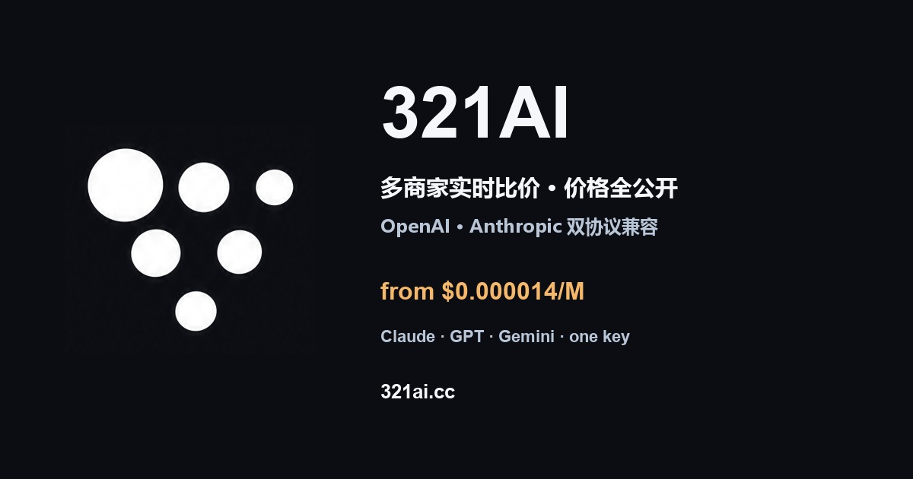
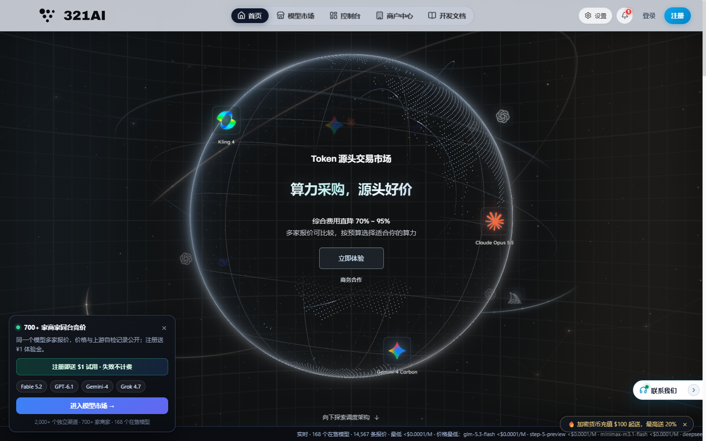
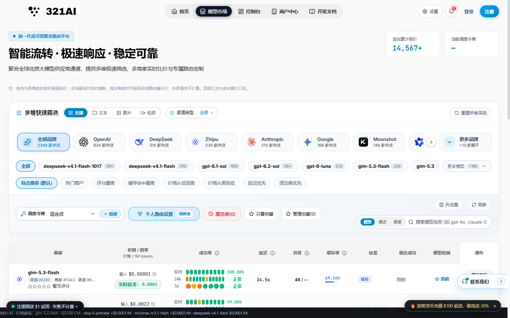
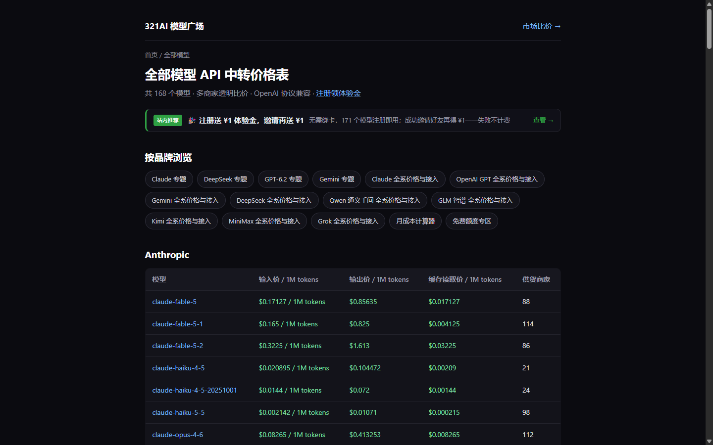
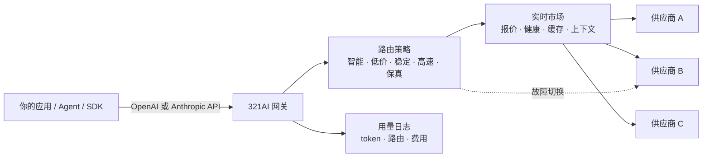
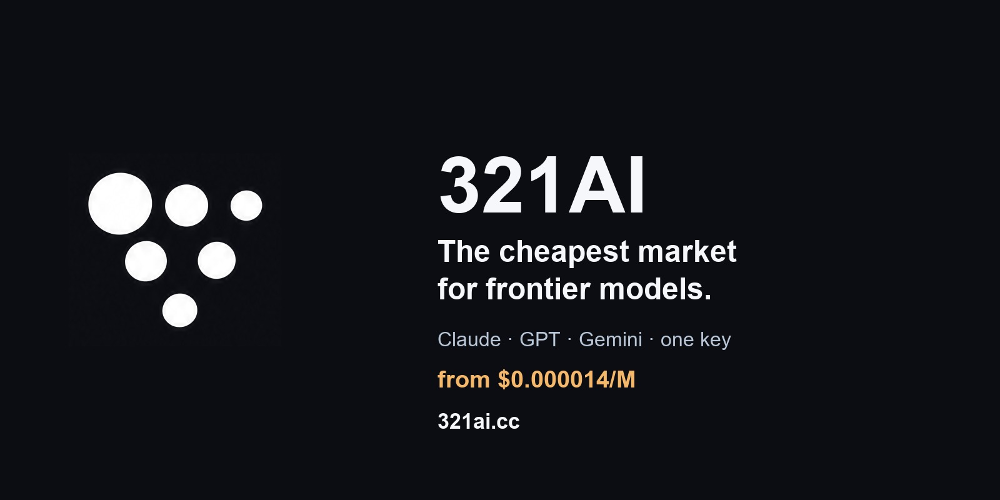

<p align="center">
  <a href="https://321ai.cc">
    
  </a>
</p>

<h1 align="center">321AI — 最便宜的前沿模型 API 市场</h1>

<p align="center"><a href="README.md">English</a> | <strong>简体中文</strong></p>

<p align="center">
  <strong>全网最便宜的 Claude / GPT / Gemini API。</strong><br>
  680+ 商家为每个请求竞价，低至 <strong>$0.000014/M</strong>。<br>
  <strong>新号送 $1</strong>，Claude Code / Codex / Cursor 即插即用。
</p>

<p align="center">
  <a href="https://321ai.cc"></a>
  <a href="LICENSE"></a>
  <a href="https://github.com/321aicc/321ai/stargazers"></a>
  <a href="https://321ai.cc/v1/models"></a>
  <a href="https://321ai.cc"></a>
</p>

<p align="center">
  <a href="#截图">截图</a> ·
  <a href="#为什么是-321ai">为什么是 321AI</a> ·
  <a href="#快速开始">快速开始</a> ·
  <a href="#路由">路由</a> ·
  <a href="#价格">价格</a> ·
  <a href="#生态">生态</a> ·
  <a href="#赞助与伙伴">赞助与伙伴</a> ·
  <a href="#faq">FAQ</a>
</p>

<p align="center">
  <a href="https://321ai.cc/#/market"><strong>Claude Sonnet 5.5 低至 $0.0405/M · GPT-6.2 Astra 低至 $0.0675/M · GLM-5.3-Flash 低至 $0.000014/M</strong></a><br>
  <sub>实时市场快照 · 价格随供给变化 · 下单时看确认价</sub>
</p>

---

## 今日价格锚点

| 模型 | 321AI 输入 / 输出（每 1M） | 官方输入 / 输出 | 约合官方价 |
|---|---:|---:|---:|
| **Claude Sonnet 5.5** | **$0.0405 / $0.2025** | $2 / $10 | **2.0%** |
| **GPT-6.2 Astra** | **$0.0675 / $0.3375** | $8 / $40 | **0.84%** |
| **Gemini 4 Neon** | **$0.0990 / $0.4950** | $3 / $15 | **3.3%** |
| **GLM-5.3** | **$0.00651 / $0.02046** | $1.40 / $4.40 | **0.47%** |
| **Qwen4 Max** | **$0.0540 / $0.1620** | $1.50 / $4.50 | **3.6%** |
| **DeepSeek V4.1 Flash** | **$0.001875 / $0.0075** | $0.30 / $1.20 | **0.63%** |

<sub>快照时间：2026-11-26 19:08 JST。市场价格每天变化；最终以确认价和账单为准。</sub>

## 一句话

你要 Claude、GPT、Gemini、DeepSeek、Qwen、GLM、Grok，以及下周才发布的新模型；但你不想为每个模型维护一套 SDK、一把 key、一个账单后台。

**321AI 把它们变成一个入口。**

```text
https://321ai.cc/v1
```

创建 Key，改 `base_url`，直接发请求。现有的 OpenAI / Anthropic 客户端继续用；321AI 在下面把请求路由到实时市场中经过筛选的商家通道。

> **不是又一个锁死的二道贩子。** 这是一个多商家、公开报价、按请求计费、自带故障切换的市场。

> [!NOTE]
> 321AI 是独立聚合网关，与 OpenAI、Anthropic、Google 等模型厂商无隶属关系；模型名称与商标归各自所有。


## 模型层坏了

你有一把 Claude key、一把 OpenAI key、一把 Gemini key、一把 DeepSeek key、一把 Qwen key、一把 GLM key、一把 Grok key，还有一张表格，用来记住哪个便宜、哪个健康、哪个刚改价。

你的 Agent 不关心这些。它只关心一件事：**此刻用对的模型、对的价格、把请求发出去。**

旧式模型接入逼你在「一个上游」和「多一套集成」之间二选一。321AI 把这个选择题删掉。

> **下一代 AI 产品不会建在一个模型上，而会建在「在多个模型之间路由」的能力上。**

## 一把钥匙，装下整个市场

<div align="center">

| **160+** | **2,000+** | **700+** | **14,000+** |
|:---:|:---:|:---:|:---:|
| 前沿与开源模型 | 供应商通道 | 独立供应商 | 实时商家报价 |

</div>

<sub>实时市场快照；供给和价格随市场变化，以市场页为准。</sub>

**同一个模型，更好的路线，更好的经济账。**

321AI 把模型接入变成实时市场：

- 每个请求都可以在多个供应商通道之间竞争。
- 每条通道都有报价、健康信号、延迟画像和缓存画像。
- 你选策略，或者固定商家；网关负责无聊的部分。
- 某条通道变慢、变贵、不可用时，路线可以在用户感知之前切换。

## 开发者用 321AI 做什么

| 谁 | 要解决的问题 | 为什么是 321AI |
|---|---|---|
| **编码 Agent** | Claude Code、Cursor、Cline、Codex CLI | 一个 Anthropic/OpenAI 兼容入口；换模型不用重接工具 |
| **AI 产品** | 对话、Copilot、研究、工作流自动化 | 一个 API 契约背后做多模型路由 |
| **Agent 平台** | 多用户、多模型、多供应商 | 按令牌路由、日志和成本透明 |
| **增长团队** | 高并发生成和批处理 | 低价/稳定策略 + 实时商家比价 |
| **基础设施团队** | 不养一支 LLM 代理团队也要稳定 | 内置故障切换、市场健康和用量日志 |
| **独立开发者** | 快速上线，不走企业采购 | 一把 key、无最低消费、不锁定 |

## 321AI 带来的变化

- **更少花费**——跟市场比，不是跟一家中间商比。
- **更高可用**——坏供应商不必变成坏请求。
- **更快上线**——OpenAI/Anthropic 兼容，不用重写。
- **更好决策**——每次请求都能看到真实服务它的路线。
- **不被锁定**——代码、prompt、供应商选择都是你的。
- **Agent 就绪**——一个入口，接上 Agent 已经在说的协议。

## 我们拒绝做什么

- **拒绝单一上游依赖。** 只有一个供应商的市场不叫市场。
- **拒绝黑箱路由。** 商家、报价、健康和路线都能看见。
- **拒绝编造 benchmark。** 仓库里的截图和数字来自真实产品截图或实时市场数据。
- **拒绝假锁定。** 如果明天 321AI 不是最优路线，你的代码仍然应该能跑在别处。

## 宣言

> 模型正在变成商品，**接入不应该变成垄断。**
>
> 模型层应该是一个市场：很多供应商、公开价格、真实竞争，上面盖一层干净 API。
>
> 321AI 的存在，就是让这个市场能被一个开发者、一个 Agent、一家公司用起来，而不把定价权交给任何一个守门人。

---

---

<a id="截图"></a>

## 截图

<p align="center">
  
</p>
<p align="center"><sub><strong>连接的模型经济。</strong> 一个入口，多个供应商，一套干净 API。</sub></p>


<p align="center">
  
</p>

<table>
  <tr>
    <td width="58%">
      
    </td>
    <td width="42%">
      
    </td>
  </tr>
  <tr>
    <td align="center"><sub><strong>模型市场。</strong> 先看商家报价、成功率、延迟、缓存和自检，再决定走哪条线路。</sub></td>
    <td align="center"><sub><strong>模型目录。</strong> 160+ 模型，输入/输出/缓存价格和供货商家数量，全部来自实时供给。</sub></td>
  </tr>
</table>

---

<a id="为什么是-321ai"></a>

## 为什么是 321AI

大多数 AI 网关只是“带价目表的代理”。321AI 在干净 API 下面放了一个**实时市场**。

| 过去 | 321AI |
|---|---|
| 一个上游账号、一个价格、一个单点故障 | 多个独立供应商为同一请求竞争 |
| 收到账单才知道哪条线路便宜 | 下单前就能看到商家报价、缓存价和自检记录 |
| 上游挂了，你的服务就挂了 | 路由可以切到另一条合格通道 |
| 每个模型一套 SDK | OpenAI / Anthropic 兼容，现有工具直接接 |
| “相信我们很稳” | 每次请求都有路由、token 和费用记录，市场可查 |

<p align="center">
  
</p>
<p align="center"><sub><strong>市场，而不是中间商。</strong> 独立供应商、实时健康信号和价格标签，围绕一个路由核心。</sub></p>

### 为 Agent 时代而生

- **Claude Code / Cursor / Cline / Codex CLI**：改 `ANTHROPIC_BASE_URL` 或 `OPENAI_BASE_URL` 就能用。
- **LangChain / LlamaIndex / LiteLLM**：OpenAI 兼容 base URL，换模型不用重写架构。
- **你自己的 Agent**：一把 key、一个账单面、一个观察成本和失败的地方。
- **多模型天生支持**：文本、推理、视觉、Embedding、图像/视频生成，一个契约。

---

## 你会得到什么

- **统一网关**：OpenAI `chat/completions`、Anthropic `messages`、流式、工具调用、Embedding、模型发现。
- **实时市场**：同一模型多个商家，输入/输出/缓存读取价直接比较。
- **路由策略**：智能、低价、稳定、高速、保真，外加按令牌/按模型固定商家。
- **故障切换**：坏通道不必变成坏体验。
- **透明用量**：请求日志、token、路由和费用在控制台一眼看清。
- **不锁定**：代码是你的，明天想换一家，架构不用重来。
- **经得起看**：公开市场、公开自检、公开错误契约、公开文档。

---

## 支持的模型与供应商

实时目录永远以 **[321ai.cc/#/market](https://321ai.cc/#/market)** 为准。

| 家族 | 代表模型 | 协议 |
|---|---|---|
| Anthropic Claude | `claude-fable-5`、`claude-opus-4-6`、`claude-sonnet-5-5` | Anthropic / OpenAI |
| OpenAI GPT | `gpt-6.1-sol`、`gpt-6.2-sol`、`gpt-5.6-luna` | OpenAI |
| Google Gemini | `gemini-4-argon`、`gemini-4-carbon`、`gemini-4-hydrogen` | OpenAI |
| DeepSeek | `deepseek-v4.1-flash`、`deepseek-v4-pro` | OpenAI |
| Qwen / GLM / Kimi | `qwen4-max`、`glm-5.3`、`kimi-k2` | OpenAI |
| xAI Grok | `grok-4.7-build-fast` | OpenAI |
| 图像 / 视频 / Embedding | Seedream、Kling、Veo、Embedding | OpenAI / 原生 |

> 供给会变。一个商家卖完，另一个商家可能还有；市场页显示实时报价和自检状态。

---

## 架构



**五层：**

1. **兼容层**：说客户端已经在说的协议。
2. **策略层**：按价格、质量、延迟或你指定的商家选路。
3. **市场层**：比较实时商家报价和健康信号。
4. **供给层**：独立上游隔离，一家挂不等于全站挂。
5. **可观测层**：每次请求都有路由、token 和账单。

---

<a id="快速开始"></a>

## 快速开始：Claude Code、Codex 与 Cursor

### 1. 拿 Key

打开 **[321ai.cc](https://321ai.cc)** → 登录 → **控制台 → 令牌管理** → 创建 Key。

新账号有少量体验金，先跑通第一次请求再充值。

### 2. 改 base_url

| 客户端 | Base URL |
|---|---|
| OpenAI SDK / OpenAI 兼容 | `https://321ai.cc/v1` |
| Anthropic SDK / Claude Code | `https://321ai.cc` |
| 模型发现 | `GET https://321ai.cc/v1/models` |

### 3. 发第一个请求

```bash
export API_KEY="sk-..."

curl -sS https://321ai.cc/v1/chat/completions \
  -H "Authorization: Bearer $API_KEY" \
  -H "Content-Type: application/json" \
  -d '{
    "model": "gpt-6.1-sol",
    "messages": [{"role": "user", "content": "用五个字打个招呼。"}],
    "max_tokens": 32
  }'
```

<details>
<summary><strong>Python — OpenAI SDK</strong></summary>

```python
from openai import OpenAI

client = OpenAI(
    api_key="sk-...",
    base_url="https://321ai.cc/v1",
)

r = client.chat.completions.create(
    model="gpt-6.1-sol",
    messages=[{"role": "user", "content": "用五个字打个招呼。"}],
    max_tokens=32,
)
print(r.choices[0].message.content)
```

</details>

<details>
<summary><strong>Node.js — OpenAI SDK</strong></summary>

```js
import OpenAI from "openai";

const client = new OpenAI({
  apiKey: process.env.API_KEY,
  baseURL: "https://321ai.cc/v1",
});

const r = await client.chat.completions.create({
  model: "gpt-6.1-sol",
  messages: [{ role: "user", content: "用五个字打个招呼。" }],
  max_tokens: 32,
});
console.log(r.choices[0]?.message?.content);
```

</details>

<details>
<summary><strong>Claude Code / Anthropic SDK</strong></summary>

```bash
export ANTHROPIC_BASE_URL="https://321ai.cc"
export ANTHROPIC_AUTH_TOKEN="sk-..."
```

Anthropic 端点为 `POST https://321ai.cc/v1/messages`；模型 ID 以控制台/市场为准。

</details>

<details>
<summary><strong>OpenAI 兼容 Agent</strong></summary>

```bash
export OPENAI_BASE_URL="https://321ai.cc/v1"
export OPENAI_API_KEY="sk-..."
```

模型 ID 从市场复制；用 `GET /v1/models` 查看当前 Key 能看到的模型。

</details>

可运行示例：[`examples/python.py`](examples/python.py) · [`examples/node.mjs`](examples/node.mjs) · [`examples/curl.sh`](examples/curl.sh)。

---

<a id="路由"></a>

## 路由：按你的方式选

<p align="center">
  
</p>
<p align="center"><sub><strong>一个请求，多个候选，一条智能路线。</strong> 价格、健康和策略共同决定路径。</sub></p>


| 策略 | 适合 | 优化目标 |
|---|---|---|
| **智能** | 大多数场景 | 价格、健康、可用性的平衡 |
| **低价** | 高并发批处理 | 最低有效成本（含缓存折算） |
| **稳定** | 生产 Agent | 成功率和一致性优先 |
| **高速** | 交互式聊天/写代码 | 首响和吞吐优先 |
| **保真** | 业务关键调用 | 更严格的质量和可用性门槛 |
| **固定商家** | 可复现成本或指定供应商 | 指定模型走指定商家/通道 |

固定商家不是牢笼：按令牌设置，商家消失时可以回落到智能路由，而不是硬报错。

### 市场页能看什么

- **商家报价**：输入、输出、缓存读取价 / 1M tokens。
- **成功率**：近期实时和 7 天信号。
- **延迟 / 并发 / 缓存率**：分清“便宜”与“好用”。
- **自检**：花钱前先做免费检查。
- **商家身份**：知道每条线路背后是谁。

---

<a id="价格"></a>

## 价格：最便宜的 Claude / GPT / Gemini，低至 $0.000014/M

**商家报价，不是黑箱数学。**

- 市场页展示每个模型的实时商家报价。
- 固定商家时显示该线路的确认价。
- 最终账单和用量日志是唯一事实源。
- **失败请求不计费。**
- 活动、充值赠送和手续费只在官网公告的有效期内生效。

公开市场没有“联系销售才给价格”的墙。线路不值这个价，就换商家或换策略。

> 价格和供给会变。大额跑批前先看市场页和确认价。

---

## 稳定性，不靠嘴

- **同一模型多供应商**：一个上游账号就是一个单点故障，321AI 围绕这个事实设计。
- **策略故障切换**：绕开坏通道，而不是把 5xx 甩给用户。
- **错误契约**：OpenAI 兼容错误结构 + request ID。
- **用量日志**：每次请求的路由、token、延迟和费用。
- **公开状态**：[321ai.cc/status](https://321ai.cc/status)。

延伸阅读：[接入指南](docs/integration.md) · [错误码](docs/errors.md) · [限流与配额](docs/rate-limits.md) · [供应商对比](docs/suppliers.md)。

---

## 支持的客户端

`OpenAI SDK` · `Anthropic SDK` · `Claude Code` · `Codex CLI` · `Cursor` · `Cline` · `Continue` · `LangChain` · `LlamaIndex` · `LiteLLM` · `Open WebUI` · `LibreChat` · `Dify` · `n8n` · 你自己的 HTTP 客户端

只要它会说 OpenAI 或 Anthropic，大概率已经能用。

---

<a id="生态"></a>

## 生态

321AI 属于一个小而独立的 AI  builder 网络。入口不同，执念相同：**让前沿模型更便宜、更好用。**

| 站点 | 是什么 |
|---|---|
| **[321ai.cc](https://321ai.cc)** | 本仓库对应的市场和 API 网关。比价、固定商家、发货。 |
| **[AgentAPI.ai](https://agentapiai.com)** | 独立、中立运营的 AI API 评测和模型基准。 |
| **[DocAI.cc](https://docai.cc)** | 文档 AI、抽取和知识工作流。 |
| **[APITokenRouter.com](https://apitokenrouter.com)** | 面向开发者的 Token 路由和 API 接入。 |
| **[Aimyria.com](https://aimyria.com)** | 网络背后的基础设施与运营。 |

### 321AI 的执念

> **模型层应该是一个市场，而不是垄断。**
>
> 你应该看得到价格、查得到供应商、随时改变主意，并且带着自己的代码离开。

---

## 重点独立伙伴：AgentAPI.ai

<a href="https://agentapiai.com"><strong>AgentAPI.ai</strong></a> 是一个**独立、中立运营的 AI API 评测与基准网站**——独立运营，不属于 321AI，也不由 321AI 拥有。

我们推荐它，是因为独立评测和公开测试记录能让 AI API 市场更容易判断。评测独立性归 AgentAPI.ai 所有；321AI 不购买、也不干预它的排名。

- 独立 API 评测与供应商对比
- 公开模型基准和测试记录
- 在选择 API 供应商之前，多一个中立视角

**从这里开始：** [agentapiai.com](https://agentapiai.com)

<a id="赞助与伙伴"></a>

## 赞助与伙伴

<p align="center">
  
</p>
<p align="center"><sub><strong>模型层应该是一个市场，而不是垄断。</strong></sub></p>


321AI 独立运营。让这套基础设施持续运转的伙伴：

| 支持方 | 贡献 |
|---|---|
| **321AI Cloud** | 平台基础设施与交付 |
| **321AI 社区** | 早期体验、测试、bug 反馈和真实意见 |

想赞助项目或与 321AI 合作？在 GitHub 开 Issue，或通过 [321ai.cc](https://321ai.cc) 联系团队。赞助名单只列已确认的伙伴，不搞花钱买 logo 墙。

---

<a id="faq"></a>

## 最便宜 API 实战手册

- [2026 年最便宜的 Claude API 是哪家？](docs/cheapest-claude-api.md)
- [Claude Code 怎么便宜用？](docs/claude-code-cheap.md)
- [321AI 与 OpenRouter 对比](docs/openrouter-alternative.md)
- [最便宜的 GPT API：GPT-6.2 Astra](docs/cheapest-gpt-api.md)
- [最便宜的 Gemini API：Gemini 4](docs/cheapest-gemini-api.md)
- [怎么比较 LLM 价格而不被套路](docs/cheapest-api.md)

## FAQ

<details>
<summary><strong>321AI 是 OpenAI / Anthropic / Google 官方产品吗？</strong></summary>

不是。321AI 是独立聚合网关，协议兼容，但与模型厂商没有隶属关系。模型名称和商标归各自所有。
</details>

<details>
<summary><strong>现有 OpenAI 代码能直接用吗？</strong></summary>

能。把 `base_url` 改成 `https://321ai.cc/v1`，换成 321AI Key，标准 `chat/completions`、流式和工具调用都不用重写。
</details>

<details>
<summary><strong>供应商挂了怎么办？</strong></summary>

路由策略可以重试或切到另一条合格通道；最终失败不计费。固定商家可以设置为回落到智能路由。
</details>

<details>
<summary><strong>同一个模型为什么有多个价格？</strong></summary>

因为有多个独立供应商。每条报价对应不同商家、缓存策略和质量画像；市场页就是让你先比较再选。
</details>

<details>
<summary><strong>会用我的 prompt 训练模型吗？</strong></summary>

321AI 只是把请求路由给选中的上游供应商来完成请求，不是模型训练方。不要发送密钥或受监管数据；隐私政策见 [321ai.cc](https://321ai.cc)。
</details>

<details>
<summary><strong>怎么报 bug 或安全问题？</strong></summary>

GitHub Issue 请带模型、时间、request ID、HTTP 状态和错误信息，**绝不要贴 Key 或个人数据**。安全问题请先通过官网私下联系团队。
</details>

---

### 最便宜的 Claude API 怎么用？

2026-11-26 快照中，Claude Sonnet 5.5 的最低价是 **$0.0405 / $0.2025 每 1M tokens**，约为官方 $2 / $10 的 2%。详见[最便宜 Claude API 实战手册](docs/cheapest-claude-api.md)和实时[模型页](https://321ai.cc/models/claude-sonnet-5-5)。价格每天变化。

### Claude Code 怎么便宜用？

把 `ANTHROPIC_BASE_URL` 指向 `https://321ai.cc`，用 321AI key，并优先选缓存经济性好的商家；完整步骤见[Claude Code 便宜接入](docs/claude-code-cheap.md)。

### 321AI 比 OpenRouter 便宜吗？

取决于具体模型、路线和缓存画像。321AI 公开实时商家报价和固定后的确认价，可以按你的真实账单比较；详见[321AI 与 OpenRouter 对比](docs/openrouter-alternative.md)。没有一句空话能代替你对自己负载的核对。

## 贡献

这个仓库是 321AI 的**公开门面与开发者文档**。欢迎：

- 修错别字、坏链接或跑不通的示例。
- 增加客户端接入指南。
- 改进错误码和限流文档。
- 带 request ID 复现 bug。

提交请使用 `feat:`、`fix:`、`docs:` 前缀；禁止提交 Key、`.env`、抓包或带 token 的截图。

详见 [CONTRIBUTING.md](CONTRIBUTING.md)。

---

## 安全

不要把 API Key 贴到 Issue、PR、截图或日志里。怀疑泄露时，先在控制台吊销 Key，再联系团队；只删 commit 不够。

---

## 支持这个项目

如果 321AI 帮你省了钱、省了时间，或者省了一次迁移：

- ⭐ **给仓库点个 Star**——让更多开发者发现一个真正可比较的多供应商选择。
- 🐦 **分享**给你的团队或 Agent 社区。
- 🧩 **开 Issue** 告诉我们你想支持的客户端。
- 💙 **赞助或合作**——见[赞助与伙伴](#赞助与伙伴)。

<p align="center"><a href="https://github.com/321aicc/321ai/stargazers"></a></p>

## License

[MIT](LICENSE) © 2026 321AI

---

<p align="center">
  <a href="https://321ai.cc"></a><br>
  <strong>别再交模型税。</strong><br>
  <a href="https://321ai.cc">321ai.cc</a> · <a href="https://321ai.cc/#/market">模型市场</a> · <a href="https://321ai.cc/#/docs">开发文档</a>
</p>

<p align="center">
  <a href="https://star-history.com/#321aicc/321ai&Date">
    
  </a>
</p>
